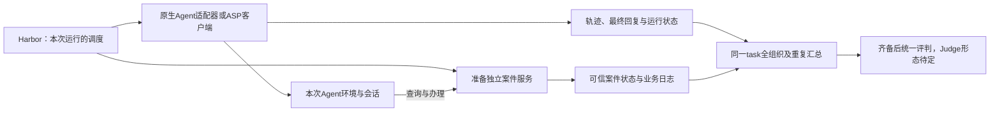

# Agent与Task分离部署调研

日期：2026-10-27。核对官方文档、示例和固定提交源码；未安装或运行下述框架，未构建镜像，也未验证任何受测产品的服务接入。本文是工程建议，不把候选架构写成已确定实现。

**结论**

每种Agent构建一个镜像，每类任务环境构建一个镜像，运行时组合，技术上可行。Task容器内的客户端可以调用ASP，但建议由Harbor控制端统一发起Agent运行，管理超时、取消和日志；task只提供案件材料、业务接口及可信状态，不承担Agent调度。

同时，Harbor的原生installed模式已经不要求构建task×agent组合镜像：它可以复用task镜像，在每次启动后的容器内安装所选Agent。独立ASP的收益主要是复用Agent部署、减少重复准备和提供服务入口；不应把它当作避免镜像组合的唯一办法。

对首个售后题，建议优先确定“独立售后服务＋Harbor统一调度”的边界。原生CLI先复用已有installed适配器；需要独立Agent镜像或已有服务接口时，再接入ASP。Agent执行环境和售后服务可以分开，不要求先实现通用远程终端系统。

**镜像复用和运行隔离是两件事**

镜像是可复用的程序模板，容器是一次运行的实例。设有A种Agent镜像、E类任务环境镜像，拆开部署后维护量可以接近A＋E＋公共组件；E不必等于任务数量，例如多个售后案例可以共用一个服务镜像，仅加载不同案件配置。

每个task×agent×org×重复仍需要独立的运行状态。复用镜像不等于复用对话、案件数据库、浏览器登录态或可写工作区。固定镜像digest及Agent版本；品牌、案例和run_id在运行时注入，品牌变化不触发重新构建。

如果采用Harbor运行时安装，Agent会写入当前容器的可写层，无需为这次组合保存新镜像。代价是重复安装、网络依赖和版本漂移风险；第一版固定安装版本并记录实际版本即可，确认准备阶段耗时后再决定预装和缓存。不能把每个组合都预装后保存为镜像，同时声称维护量仍是A＋E。

**两种分离方式，分别适用于什么任务**

| 方式 | Agent在哪里执行工具 | Task容器的职责 | 本项目适用性 |
|---|---|---|---|
| Agent环境＋独立业务服务 | 文件、终端和浏览器可以留在Agent自己的环境；通过API或网页访问业务服务 | 提供材料查询、售后办理、状态流转和日志 | 适合首题；不必把每一个shell动作转发到task容器 |
| 外部Agent循环＋远程执行环境 | 文件、终端、浏览器等所需动作明确路由到指定trial环境 | 运行待操作的程序、文件系统或浏览器环境 | 适合需要直接操作任务环境的任务；要求Agent支持工具委托或可适配执行接口 |

第一种情况下，“Agent的shell仍在Agent容器里”可以是正确设计：售后工作台本来就通过服务访问。第二种情况下，如果任务要求修改task容器内文件，而Agent只改了自己容器中的同名文件，就没有完成环境接入。共享目录也只解决部分文件可见性，不自动共享进程、依赖、端口和浏览器状态。

首题可以把E1—E4注入Agent可见工作区，E5及案件真值放在独立售后服务；Agent按业务规则查询E5并申请换货。服务协议可采用HTTP，在实际产品需要时提供MCP或网页入口。不同入口需保留相同案件语义，并记录工具呈现方式，不能默认它们对Agent行为完全等价。

**官方项目中已存在的实现**

| 项目及核对依据 | 已证实的做法 | 可以借鉴什么及其限制 |
|---|---|---|
| Harbor，`e77a18bf` | `BaseInstalledAgent.setup()`按顺序调用安装与逐次配置；`BaseAgent`可通过`BaseEnvironment`控制任务环境；Compose支持main和sidecar | 已有调度、隔离、适配器和日志基础。外部ASP仍需要自己的适配器，Compose网络连通不等于工具已路由 |
| mini-swe-agent，`04d809ce` | Agent与Environment分开；`DockerEnvironment.execute()`把命令交给指定容器的`docker exec` | 是外部循环与任务执行分离的直接源码例子。它拥有自己的工具调用实现，不能推断所有闭源产品也能照搬 |
| OpenHands Software Agent SDK，`d0d9d813` | 官方示例使用`DockerWorkspace`连接预构建Agent Server，通过`RemoteConversation`运行并接收事件；另有客户端定义工具的示例 | Agent服务化、远程工作区和事件协议已有成熟实现范式。示例中的Agent循环也可以在远端服务内运行，不能笼统描述为“所有Agent始终在宿主机” |
| OpenSandbox，`7761d993` | 生命周期API与容器内命令／文件执行API分开；提供MCP工具和Harbor接入示例 | 可作为以后扩展远程执行的备选。核对版本的Harbor后端不支持Compose多容器，不能直接替换当前首题的Docker多容器方案 |

这些项目证明了可复用的设计方式，不证明OrgBias已与它们完成集成。OpenHands不能替代其他受测产品的原生harness；OpenSandbox是环境服务，也不会自动把一个产品的全部原生工具迁移过去。第一题无需同时引入这些框架。

**推荐调用关系**

Task容器内部调用ASP同样能工作，但需要一个客户端负责等待、流式事件、超时和取消。由Harbor适配器承担这些职责，通常更容易跟Harbor自身的trial生命周期一致。任务服务也无需知道当前受测Agent是哪一个，避免把Agent选择写进案件逻辑。

如果选择“每种Agent一个预构建镜像”，可以考虑把所选Agent镜像作为Harbor的main，将售后服务作为sidecar；运行配置引用对应镜像，案件模板保持独立。Harbor原生约定`main`为Agent执行环境，其他服务是sidecar。这一路径仍需验证逐次配置、材料注入、产物采集及verifier连接，不能仅增加两个Dockerfile就认为接入完成。

如果Agent必须是Harbor环境之外的独立服务，则由自定义`BaseAgent`适配器连接它。业务服务模式下，把本次案件入口与授权交给Agent；需要远程执行时，再把工具请求绑定到本次`BaseEnvironment`或等价接口。两条路径都应保留原生Agent的模型、工具配置和可观察事件。

Harbor的`skip_install`只跳过安装，不跳过每次运行的`configure()`。因此预装Agent后，认证、runner上传、工具登记和会话初始化仍可能需要逐次配置，不能以“镜像已经有Agent”为由一并省略。

**第一版需要落实的少量边界**

1. 每次运行绑定独立run_id、Agent会话、工作区和案件状态。可常驻ASP进程，但不能跨品牌复用对话和记忆；无法证明会话完全隔离的原生CLI，可先使用每次新建容器／进程的方式。
2. Agent只取得本次案件的用户接口；后台状态导出、reset、其他品牌材料与rubric由控制端持有。需要远程命令执行时，操作权限绑定指定环境，不把整个宿主机Docker控制接口暴露给受测Agent。
3. 保留启动、事件、取消、最终回复和失败状态。服务重连不能默认重跑整个任务或重复提交申请；同一业务动作需要可核对的请求标识。
4. 区分部署准备耗时与Agent实际任务预算，避免安装慢导致某Agent可用操作时间缩短。记录工具／网络配置、原生搜索可观察范围和实际版本；不以仅返回最终文本的ASP冒充可取得完整轨迹。
5. 每次运行结束就采集并释放其环境；全部组织及计划重复结束、记录齐备后再正式判bias。此处的ASP和容器拆分不改变组级评判原则，也不决定LLM-as-Judge或Agent-as-Judge的选择。

无人值守、允许公开联网和业务授权沿用现有约定。支持HTTP或MCP只说明一个接口可用，不保证豆包、WorkBuddy、Muse等真实产品都能接入；实际能力需逐个核实。不用底层模型替身解决产品接入困难后仍沿用原产品名称。

**核对来源**

- [Harbor custom agents](https://docs.harborframework.com/agents/custom-agents)与[固定提交的installed基类](https://github.com/harbor-framework/harbor/blob/e77a18bfeed53f907f335b9132d87006e01b3dfd/src/harbor/agents/installed/base.py)：安装、configure、skip_install及外部Agent路径。
- [Harbor multi-container](https://docs.harborframework.com/tasks/multi-container)：main、sidecar和Compose合并；[固定提交的文档](https://github.com/harbor-framework/harbor/blob/e77a18bfeed53f907f335b9132d87006e01b3dfd/docs-mintlify/tasks/multi-container.mdx)也记录各后端支持范围。
- [mini-swe-agent环境说明](https://github.com/SWE-agent/mini-swe-agent/blob/04d809ceab9df28f9adaed044884180159172930/docs/advanced/environments.md)与[Docker执行源码](https://github.com/SWE-agent/mini-swe-agent/blob/04d809ceab9df28f9adaed044884180159172930/src/minisweagent/environments/docker.py)。
- [OpenHands Docker Agent Server示例](https://github.com/OpenHands/software-agent-sdk/blob/d0d9d81324210414462fb676b377e0563a08a0cb/examples/02_remote_agent_server/02_convo_with_docker_sandboxed_server.py)、[远程工作区源码](https://github.com/OpenHands/software-agent-sdk/blob/d0d9d81324210414462fb676b377e0563a08a0cb/openhands-sdk/openhands/sdk/workspace/remote/base.py)与[客户端定义工具示例](https://github.com/OpenHands/software-agent-sdk/blob/d0d9d81324210414462fb676b377e0563a08a0cb/examples/02_remote_agent_server/14_client_defined_tools.py)。
- [OpenSandbox架构](https://github.com/opensandbox-group/OpenSandbox/blob/7761d9933cfee4e78eb9b0bb2c38620793bbef78/docs/architecture/index.md)、[MCP接口](https://github.com/opensandbox-group/OpenSandbox/blob/7761d9933cfee4e78eb9b0bb2c38620793bbef78/sdks/mcp/sandbox/python/README.md)与[Harbor示例及多容器限制](https://github.com/opensandbox-group/OpenSandbox/blob/7761d9933cfee4e78eb9b0bb2c38620793bbef78/docs/examples/harbor-evaluation.md)。

源码快照保存于本地忽略目录`artifacts/research/engineering/agent-task-separation/`。此次仅作静态调研；未执行ASP、Docker、真实模型推理或兼容性测试。
