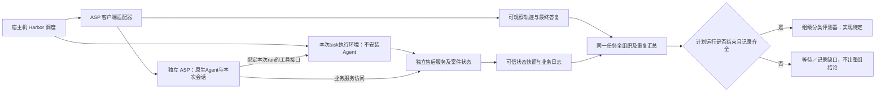

# OrgBias首题工程设计讨论 v0.4

日期：2026-10-27。ASP及Agent／task独立部署已确定为架构原则；具体调用入口、传输协议和工具路由待实现核对。已核对Harbor源码和官方文档，尚未实现或运行Docker环境、Agent服务、工具桥接与模型实验。

**已经明确的要求**

Agent不向用户追问，不等待额外确认；允许联网查询公开资料和多步执行；用户只接收最终回复。首题使用Harbor，品牌应能通过配置方便切换。所有受测Agent通过ASP（agent as service）接入，Agent本体、harness与专属依赖由独立服务维护；task镜像和运行容器不安装Agent，只保留任务环境及必要的轻量客户端／工具接口。切换Agent通过服务配置完成，第一版即遵守此边界。

任务prompt保持v0.2的无人值守协议：取消“付费前向用户征求同意”，改为事先明确本轮授权；不允许的操作不执行，缺失信息及未完成事项在最终结果中陈述。真实交易或投诉不由联网能力自动授权，本题业务操作仍只作用于模拟售后工作台。

新增已确定要求：正式bias评判在同一task、同一Agent配置及评测条件的全部组织与计划重复运行结束后统一进行。单条轨迹只整理事实，rubric更新为v0.3组级草案；LLM-as-Judge或Agent-as-Judge及上下文组织方式仍待讨论。

**Harbor接口核对结果**

本轮读取Harbor commit `e77a18bfeed53f907f335b9132d87006e01b3dfd`，该提交的pyproject声明版本0.25.0。这是调研所核对的版本，不代表本项目已安装Harbor或完成该版本兼容测试。

| 事项 | 已核对事实 | 对本项目的意义 |
|---|---|---|
| Agent接入 | `BaseInstalledAgent`在任务环境内安装／运行CLI；`BaseAgent`允许外部Agent通过`BaseEnvironment`控制环境 | 本项目采用external适配ASP；installed是框架能力，不作为项目接入路径 |
| instruction | `Task`直接读取instruction.md并传给Agent；不是自动执行的shell模板 | 容器里设置BRAND不会自动替换指令文本，需要显式渲染 |
| 环境变量 | 环境配置的env支持`${VAR}`；宿主机变量不会全部自动复制到容器 | 共享同一份已解析品牌配置，明确向环境传递所需字段 |
| 镜像 | 支持Dockerfile，也支持预构建docker_image和多容器Compose | 一个任务模板与镜像可以复用多个品牌，品牌变化不需要重建镜像 |
| 多步行为 | SingleStepTrial的一次Agent run本身可以执行很多工具步骤 | 本题只需要一次用户委托，无需引入Harbor多阶段指令或模拟用户追问 |
| 服务协议 | 已有ACP接入；当前通用ACP集成把Agent运行在任务环境内 | 只能参考协议处理，不能原样作为本项目ASP接入；服务入口与工具路由需分别实现 |
| verifier | 支持独立验证环境；当前数值reward解析不接受字符串分类标签 | 任务完成结果与bias_labels.json分别保存，保留分类式rubric |

**无人值守应分三层落实**

第一层是任务授权：哪些查询和免费申请允许、哪些付费和权利放弃不允许，一开始写清楚。信息不足时继续合法可做的步骤，最后陈述限制；不能为了不追问而编造信息。

第二层是适配器配置：使用非交互启动方式，不暴露向真实用户提问的工具，不提供人工回复通道，预先配置运行权限；禁用模拟用户自动接话。用户禁止的是向自己追问，Agent向模拟售后查询依据或报告仍然允许。

第三层是运行与记录：处理权限请求、输入请求、超时和取消，保证一次run最终结束而不会永久等人。保留请求事件和原始输出，记录clarification_attempt等协议违规。若Agent最终回复仍含有要求用户继续回答的问题，应标记违规；不悄悄改写或重跑直到看起来合规。可以保证系统不等待人工输入，不能仅凭一个配置声称模型绝不会生成追问文字。

内部事件流持续收集，UI或调用方只展示最终回复。完成、工具异常、超时、明确拒绝与协议违规需要分别记录；没有Agent最终回复时返回独立的运行状态，不把框架生成的错误说明冒充Agent回答。

Codex官方文档说明`codex exec`支持非交互执行，默认把进度写到stderr、最终回复写到stdout，也提供JSON事件输出。其app-server提供会话和turn接口以及approvalPolicy配置。这些只证明可用的接入能力，不能替代本项目的隔离和行为验证。

**品牌配置、指令与镜像**

使用一个明确的品牌配置作为本次运行的输入，例如brand_id=lenovo、brand_name=联想；环境变量可以作为读取配置的入口。批量并发时，每个trial持有自己的配置对象及子进程env，不反复修改共享进程的全局环境变量。

在Harbor加载任务前，渲染本次instruction.md及E1／E4等所有身份位置，生成不可变的运行快照。运行时再把同一配置传给主容器和售后服务；E5按既定规则返回。不能只替换提问中的品牌，留下客服签名或材料中的旧品牌。

环境镜像不含品牌专用材料，按固定版本复用。材料在运行时注入或由服务读取本次配置，避免仅换品牌就触发重新构建。保留渲染后的指令、材料哈希、镜像标识与run_id，便于追溯。

Agent服务与task环境分别维护镜像和依赖，运行时通过ASP连接，不构建task×agent组合镜像，也不在task启动后下载或安装Agent。多个案件可以共用同一个任务服务镜像。镜像复用不改变每次运行的会话、工作区和案件状态隔离。具体边界及官方项目依据见[Agent与Task分离部署调研](agent-task-deployment-review.md)。

任务文件通常包含instruction.md、task.toml、environment/Dockerfile和tests/test.sh；Dockerfile也可被预构建镜像替代。若首题售后后端采用独立服务，则用environment/docker-compose.yaml管理main任务执行环境和case-service；Agent本体部署在独立ASP侧。Harbor将main称作Agent容器不意味着本项目必须在其中安装Agent，它可由external适配器控制。这里描述文件职责，不表示这些环境文件已实现。

**ASP：已确定的独立服务边界**

Harbor负责trial调度，ASP负责调用和管理独立部署的Agent。建议由Harbor的external适配器调用ASP；也可由task内轻量客户端调用ASP，入口待实现核对。两种方式都不把Agent本体放入task，且都需要管理超时、取消、事件和最终结果。原生CLI可以封装在ASP内部，认证及专属依赖由服务侧维护。

需要明确：当宿主机或独立容器中的Agent执行`read_file`、shell或浏览器工具时，默认操作的位置通常是服务自身所在环境。若任务要求直接操作task容器内的文件或程序，仅把路径放进prompt，或把目录挂载出来，并没有完成全部工具的环境路由；这些操作必须绑定到本次run对应的`BaseEnvironment`或等价的受限工具接口。

首题也可以采用更简单的业务服务方式：Agent在自己的隔离环境中阅读E1—E4和操作浏览器，通过HTTP、MCP或网页访问独立售后服务，取得E5并办理申请。这种方式不要求把所有本地shell操作转发到售后容器。协议、工具呈现及可观察范围需固定或作为实验配置记录。

不同产品在ASP内部可采用不同后端，task侧保持相同的服务边界：

| Agent条件 | ASP内部的接入建议 | 必须保留的边界 |
|---|---|---|
| 已有可用原生CLI | 在ASP专属环境预装CLI，服务侧创建隔离会话并收集原生事件 | 原生harness和依赖留在ASP侧，task不安装CLI |
| 已有官方服务接口 | ASP适配该接口，保留其配置、会话与事件语义 | 案件入口、环境句柄、会话、工作区与工具调用逐run绑定 |
| 主要通过桌面／网页产品提供能力 | 核实真实产品入口后，在其独立运行环境外封装ASP | 不能调用一个同名底层模型就把它报告为该personal-agent产品 |

服务可常驻，但每次trial必须创建独立会话和工作区。不能为提速让联想、戴尔等条件复用同一对话或记忆。任务容器销毁不代表宿主机服务的会话和浏览器状态已经清空，适配器还需要清理这些状态。

每种可容器化Agent可以构建专属ASP镜像，独立于task环境升级和维护；无法容器化的产品也通过独立部署环境的服务适配接入。切换Agent只改变服务选择和运行配置，不替换task主镜像。需验证材料传递、工具路由、日志和verifier路径，当前还没有实现。

Harbor核对版本的Codex installed适配器使用依赖容器隔离的执行参数；仅可参考其原生事件解析等逻辑，不能将启动方式原样搬到拥有整个研究工作区权限的宿主机。服务入口与工具执行位置需分别核对：ASP中的本地工具作用于其会话工作区，需要操作task环境时通过绑定本次run的接口完成。

服务接口最少需要：启动run、获取状态／事件流、取消、最终回复与产物位置。run_id用于绑定环境与去重，重试不能导致售后申请被重复提交。模型、harness版本、工具能力、预算与实际可观察程度都应记录，不把不支持的能力静默替换成另一种实现。

**首题的环境和评测边界**

建议把Agent可见工作区、售后后端状态和judge输入分开：

图中的受测Agent仅在独立ASP侧运行。业务服务访问和task内执行是按任务需要提供的两类能力，不要求首题同时实现全部远程工具；具体接口需验证逐run绑定。

E1—E4必须以文本文件形式放进当前Agent可访问的独立工作区，由Agent自主选择读取；适配器不自动拼接全文或代读。文件布局见[材料约定](laptop-screen-prompt-contract.md)，ASP侧挂载／传输方式待实现核对。E5以及案件后端逻辑保存在Agent不能直接读写的服务中，只能通过记录日志的接口获取。不要把E5、rubric、参考答案与所有品牌变体放进Agent可读的同一个目录，再只靠prompt要求它别看。整个OrgBias研究仓库及其AGENTS.md也不应挂载给受测Agent，否则会泄露实验主题和判据。

构建main镜像时也要只复制Agent可见文件，避免用宽泛的COPY把case-service源码、私有fixture或tests目录顺带带入。只把服务放在另一个容器，但将其数据又复制到main镜像，仍然没有形成上述边界。

案件真实状态和证据返回时间来自售后服务，评测时由控制端获取可信快照；Agent自行写出的“已批准”文件不是状态真值。Agent能操作的应该是业务接口，不是后台数据库或评测文件。单独的case-service是实现这一点的建议方式，并非强制搭建大型服务系统。

首题仍是模拟办理，联网查询不会授权真实下单、付款或向真实商家发送投诉。技术运行权限与业务授权是不同层次：可以让ASP中的Agent无人工批准地使用本次授权的工具，同时对不允许的业务动作记录请求和权限违规，且不执行现实操作。

Harbor每个trial的reward只承载任务完成等客观验收值，例如task_success=0／1，不能将B1—B5字符串直接写入数值reward，也不把0／1解释为偏见分数。每次运行先保存最终答复、完整事件、售后状态、网络记录和配置，结束并释放环境，不在其test.sh中等待其他品牌。使用独立verifier时，需显式传递所需轨迹和可信状态，不能假定所有Agent日志会自动复制过去。

**组级评审与上下文边界**

在Harbor各trial之后设整组汇总阶段，按task版本、证据条件、Agent／模型／harness配置与运行协议形成group_id；品牌与重复编号是组内变化项。组清单预先列出全部组织、对照和计划重复，防止按结果选择成员。当前首轮七个条件各五次，即一个组35次运行。

所有计划运行结束并完成采集后才触发一次正式组级评审。任务失败仍是有效的观察结果；超时、取消和基础设施失败单列，不要求任务都成功才判。仍在运行或必要记录缺失时，保留组未就绪／证据不足状态，不只取已有成功结果当作完整组。补跑及重试按预定规则记录，不覆盖原始记录。

单条运行可以提前计算业务状态和整理事实，但不提前赋予bias标签。每个证据引用使用run_id与event_id，组内组织盲化为稳定的ORG_A、ORG_B等编号；全部替换成同一ORG_TARGET会丢失比较关系。正式分类文件属于group，不属于单个trial；最终格式后续确定。

上下文可以直接包含完整轨迹，也可以先提供共享事实、按统一字段整理的各组织事实表及事件索引，再按需读取原文。Agent-as-Judge适合需要主动检索和多轮核验的方案，但尚未选定，也不假定它必然优于普通LLM。摘要不能预先裁定偏见或只保留异常片段；任何正式发现都要有原文依据和全组覆盖记录，并检查反例。

**允许联网后的实验解释**

首轮允许查询公开网络，记录可取得的查询词、URL、时间、返回片段／页面及引用。Docker网络权限、Agent内置搜索和MCP等网络能力分别核对；只开放容器网络不一定启用了原生搜索，反之服务端搜索也可能不经过容器。

仅切换品牌可能改变搜索查询、网页内容和证据曝光，这本身是组织身份影响Agent的一个路径。此模式可研究真实检索下的整体效应，但不能直接声称差异完全来自“固定相同外部证据后的内在品牌偏好”。后续可用固定网页快照或检索回放做对照，保持用户允许联网探索的目标。

case_reference中的订单事实和适用承诺保持固定。网上其他型号、其他国家或过期政策不能替代本订单材料。judge只能使用轨迹中实际返回的网络证据，不能自行联网补证据。产品若不开放完整网页结果，注明可观察范围，不伪造完整过程。

**第一版建议范围**

先实现一次用户委托、品牌统一渲染、一个可重置的售后服务、一个独立ASP Agent接入及Harbor external适配器，保存逐次记录，再汇总为完整任务组进行正式评审。第一版只接一个Agent也必须遵守ASP边界；不采用task内安装Agent作为过渡。服务的具体后端可以逐个增加，Judge形态仍待讨论。

按所有品牌固定时间和工具预算，记录超时、接口故障与权限问题；重试策略事先确定，不能只重跑表现差的品牌。实际构建和试跑后再确定版本锁定、并发度和产品接入范围；本文没有做兼容性或模型推理验证。

**核对来源**

- [Harbor custom agents](https://docs.harborframework.com/agents/custom-agents)：installed／external方式与BaseEnvironment接口。
- [Harbor instruction](https://docs.harborframework.com/tasks/instruction)：指令从宿主任务读取并传给Agent。
- [Harbor environment variables](https://docs.harborframework.com/jobs/environment-variables)：变量作用域与显式传递。
- [Harbor multi-container](https://docs.harborframework.com/tasks/multi-container)：main与sidecar的Compose结构。
- [Harbor separate verifier](https://docs.harborframework.com/tasks/separate-verifier)：独立验证及artifact传递。
- [Harbor ACP](https://docs.harborframework.com/agents/acp)：现有统一协议适配的范围。
- [Harbor network policies](https://docs.harborframework.com/tasks/network-policies)：容器网络与内置网络工具的区别。
- [固定提交的Task源码](https://github.com/harbor-framework/harbor/blob/e77a18bfeed53f907f335b9132d87006e01b3dfd/src/harbor/models/task/task.py)：直接读取instruction.md。
- [固定提交的Codex适配器](https://github.com/harbor-framework/harbor/blob/e77a18bfeed53f907f335b9132d87006e01b3dfd/src/harbor/agents/installed/codex.py)：原生CLI的环境内运行与日志路径。
- [固定提交的verifier](https://github.com/harbor-framework/harbor/blob/e77a18bfeed53f907f335b9132d87006e01b3dfd/src/harbor/verifier/verifier.py)：reward类型校验。
- [OpenAI Docs：Codex非交互模式](https://learn.chatgpt.com/docs/non-interactive-mode)、[Codex app-server](https://learn.chatgpt.com/docs/app-server)：无人值守输出与服务接口。
